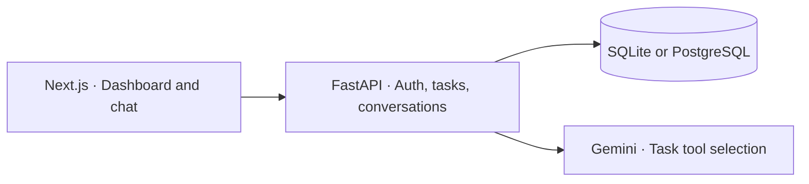

<div align="center">

# NexaFlow

**A task dashboard you can talk to.**

Plan your work with priorities, due dates, and filters. When a task comes to mind, add it in plain language and get back to what you were doing.

[Quick start](#quick-start) · [Architecture](#architecture) · [Verification](#verification) · [Deployment](#deployment)

</div>

## A day with NexaFlow

| Say this in chat | Then open the dashboard |
| --- | --- |
| “Remind me to buy milk.” | Find the new task in your list. |
| “Show my pending tasks.” | Use status and priority filters to focus your view. |
| “Mark ‘buy milk’ as complete.” | See the task move into your completed list. |

Search and edit tasks directly from the dashboard at any time. Sign in again to revisit your saved tasks and conversations.

## Architecture



| Layer | Implementation |
| --- | --- |
| Interface | Next.js, React, TypeScript, Tailwind CSS, TanStack Query |
| API | FastAPI with JWT authentication and interactive OpenAPI docs |
| Data | SQLModel with SQLite locally and PostgreSQL for hosting |
| Assistant | Gemini selects task tools scoped to the signed-in account |

## Quick start

You'll need Python 3.11+, Poetry, Node.js, and a Gemini API key for live chat.

**1. Configure the API**

Create `backend/.env` and replace the placeholder values with a random secret and your Gemini key.

```dotenv
DATABASE_URL=sqlite+aiosqlite:///./nexaflow.db
SECRET_KEY=replace-with-a-random-secret
GEMINI_API_KEY=replace-with-your-key
```

```sh
cd backend
poetry install --only main --no-root
poetry run uvicorn src.main:app --reload --port 8000
```

**2. Start the web app**

In a second terminal, run these commands from the repository root.

```sh
cd frontend
npm ci
npm run dev
```

Register at [localhost:3000](http://localhost:3000). The [interactive API reference](http://127.0.0.1:8000/docs) runs alongside the app.

## Verification

From `backend`, install the test dependencies and run the chat integration test.

```sh
poetry install --no-root
poetry run python -m unittest test_chat_integration
```

The test uses isolated SQLite and covers task creation, listing, completion, conversation history after signing in again, and account isolation. Set `NEXAFLOW_TEST_LIVE_AI=1` to run the same flow against Gemini. From `frontend`, run `npm run build` to check the production build.

## Deployment

| Service | Project root | Settings |
| --- | --- | --- |
| Render Python web service | `backend` | Build with `poetry install --only main --no-root`. Start with `poetry run uvicorn src.main:app --host 0.0.0.0 --port $PORT`. |
| Vercel Next.js project | `frontend` | Set `NEXT_PUBLIC_API_URL` to your Render URL followed by `/api/v1`. |

Set `SECRET_KEY`, `GEMINI_API_KEY`, and `DATABASE_URL` on Render. Use a managed PostgreSQL URL with the `postgresql+asyncpg://` scheme. Once Vercel assigns your domain, set `CORS_ORIGINS` on Render to a JSON array such as `["https://your-app.vercel.app"]`. Redeploy the API, then verify registration, task operations, and saved conversation history from the hosted app.

## Project specs

[Full-stack application](specs/001-phase-2-full-stack/spec.md) · [Conversational assistant](specs/002-phase-3-chatbot/spec.md)
